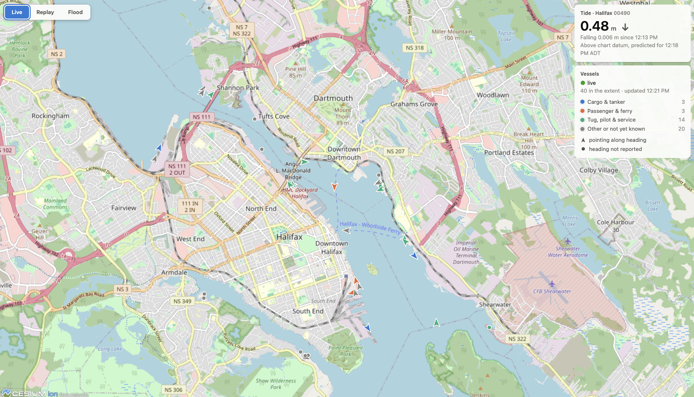
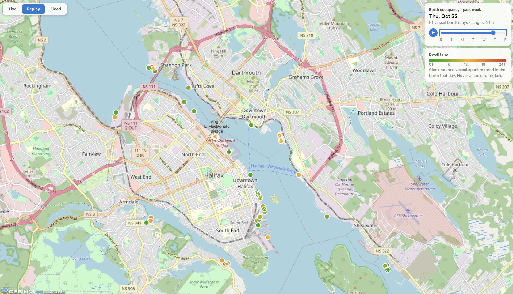
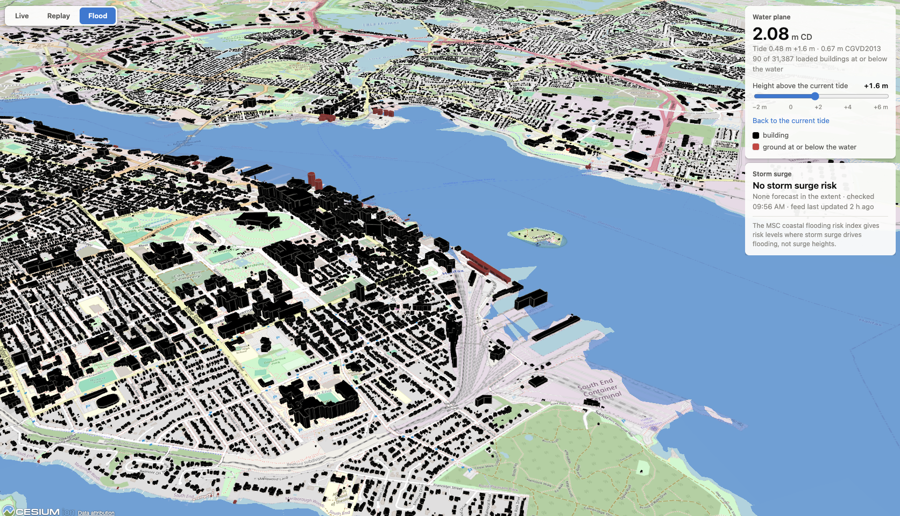

# Port and Coastal Operations Twin (vibe-coded)

A digital twin of Halifax Harbour, Nova Scotia, built with [Claude Code](https://claude.com/claude-code).
It brings together live vessel positions (AIS), the CHS tide level, the MSC coastal flooding risk
index, topo-bathymetric terrain and 3D buildings in a CesiumJS app with three panels:

- **Live** (2D): vessels as icons pointing along their heading, coloured by ship type, and the
  current tide level with a rising or falling arrow. The vessels card says when the ship feed
  can't be reached, when no positions have been collected, or when the newest position is over
  5 minutes old (usually because `ais_consumer.py` has stopped).
- **Replay** (2D): berth occupancy for the past week, with a day slider. Circles go from green to
  red as dwell time increases, and hovering shows each vessel's details.
- **Flood** (3D): terrain and buildings with a water plane at the current tide level. A slider
  raises and lowers the water, and buildings whose ground is at or below it turn red. The panel
  also shows the current storm surge flooding risk. If the terrain or building tiles haven't
  been built, a notice at the top of the panel names the scripts to run.

Almost all of the code was written by Claude and Claude Code from the prompts below, with the
decisions made along the way recorded under [Decisions](#decisions).

## Contents

- [Repository layout](#repository-layout)
- [Setup](#setup)
- [Running it](#running-it)
- [The app](#the-app)
- [Scripts](#scripts)
- [Data and vertical datums](#data-and-vertical-datums)
- [How it was built](#how-it-was-built)
- [Decisions](#decisions)

## Repository layout

```
scripts/
  load_rasters.py               load and merge the DTM and NONNA-10 bathymetry
  export_terrain.py             merged raster -> Cloud Optimized GeoTIFF + Cesium terrain tiles
  fetch_buildings.py            NRCan building footprints for the extent -> building_proj.gpkg
  extrude_buildings.py          building footprints -> 3D solids
  export_buildings_3dtiles.py   3D solids -> Cesium 3D Tiles
  ais_consumer.py               live AIS from aisstream.io -> GeoParquet, plus berth analysis
  ais_live.py                   websocket feed of the latest vessel positions
  tide_consumer.py              CHS IWLS tide level -> Parquet every 5 minutes
  tide_live.py                  websocket feed of the latest tide level and trend
  storm_surge_consumer.py       MSC coastal flooding risk index -> GeoParquet every 30 minutes
  storm_surge_live.py           websocket feed of the current storm surge risk
  twin_app.py                   serves the CesiumJS app, terrain, tiles and the three feeds
  twin_app/                     the app: index.html, app.js, style.css
  test_*.py                     unit tests (python -m unittest)
```

## Setup

All data lives in the repository's [data/](data/) folder, `DATA_DIR` in
[scripts/load_rasters.py](scripts/load_rasters.py). Generated outputs are written there too. The
inputs it expects are:

| File | What it is |
|---|---|
| `extent.gpkg` | the project extent, a 10 km square polygon in EPSG:2961 |
| `dtm_1m_utm20_w_4_94.tif` | 1 m lidar DTM (NRCan HRDEM), EPSG:2961, CGVD2013 heights. Downloaded from `DTM_URL` on first run if missing; if the server refuses, download it in a browser and save it here |
| `NONNA10_4460N06360W.tiff`, `NONNA10_4460N06370W.tiff`, `NONNA10_4470N06370W.tiff` | CHS NONNA-10 bathymetry tiles, WGS 84, chart datum heights. They come from the CHS NONNA download cart |
| `auto_building_opti_2.parquet` | NRCan automatically extracted buildings for all of Canada (2.4 GB GeoParquet). Download it from `BUILDINGS_URL` in [scripts/fetch_buildings.py](scripts/fetch_buildings.py) with a browser: the server refuses scripted downloads. Not committed |
| `building_proj.gpkg` | the extent's building footprints with `elevmin` and `heightmax`, in EPSG:2961. Written by `fetch_buildings.py` from `auto_building_opti_2.parquet` |
| `berth.gpkg` | named berth polygons in EPSG:2961, for the berth occupancy analysis. Drawn for this project, not an official dataset |

Everything runs on Python 3.14. Install the packages with:

```bash
pip install -r requirements.txt
```

The AIS consumer needs a free API key from [aisstream.io](https://aisstream.io) in the
`AISSTREAM_API_KEY` environment variable. Getting the key needs a GitHub login, so you'll need a
GitHub account. The CHS and MSC APIs need no key.

## Running it

Run everything from `scripts/`.

**1. Build the terrain and buildings (once, or when the source data changes):**

```bash
python export_terrain.py            # merge DTM + NONNA-10, write the COG and DATA_DIR/terrain/
python fetch_buildings.py           # write DATA_DIR/building_proj.gpkg
python extrude_buildings.py         # write DATA_DIR/building_3d.gpkg
python export_buildings_3dtiles.py  # write DATA_DIR/buildings_3dtiles/
```

`python load_rasters.py` on its own prints a summary of both rasters and writes the merged raster.

**2. Start the three consumers (each runs until stopped with Ctrl+C):**

```bash
AISSTREAM_API_KEY=... python ais_consumer.py
python tide_consumer.py
python storm_surge_consumer.py
```

**3. Run the berth analysis once a day** (for example from cron), for the Replay panel:

```bash
python ais_consumer.py --compact             # yesterday (UTC)
python ais_consumer.py --compact 2026-10-22  # a given day
```

**4. Start the app and open http://localhost:8000:**

```bash
python twin_app.py
```

`twin_app.py` serves the app over HTTP on port 8000 and runs the three websocket feeds itself,
all on port 8765 at `/vessels`, `/tide` and `/storm_surge` (`--port` and `--feed-port` change
the two ports). Each feed can also run on its own, for example `python tide_live.py`.

Behind HTTPS, the page connects to the feeds with `wss://` on the same host. Put a TLS proxy
(nginx, Caddy and so on) in front of both ports, 8000 and 8765, and let it pass websocket
upgrades through on 8765.

**Tests:**

```bash
python -m unittest
```

## The app

The app is plain HTML and JavaScript on a single CesiumJS 1.146 viewer, loaded from a CDN.
Switching tabs changes the scene between 2D and 3D. OpenStreetMap is the base map, so no Cesium
ion token is needed. Open a panel directly with `?tab=live`, `?tab=replay` or `?tab=flood`.

### Live



- **Vessels:** each vessel's latest position from the last 10 minutes of AIS files, updated as
  the consumer writes new files. The icon points along the reported heading, or the course over
  ground while the vessel is moving. Vessels with neither show as a circle.
- **Colours:** Cargo & tanker (blue), Passenger & ferry (orange), Tug, pilot & service (green), and
  grey for every other type or a type not yet reported. The legend counts each group, and
  hovering a vessel shows its name, exact type, MMSI, navigational status, speed, course, heading
  and when it last reported.
- **Tide:** the latest level at Halifax (station 00490) in metres above chart datum, with an
  arrow for rising, falling or steady. The card says whether the level is observed or predicted,
  and flags a stale reading.

### Replay



- One circle per vessel and berth for each of the past 7 days, at the vessel's mean position in
  the berth.
- The colour runs from green (short stay) to red (24 hours) on a fixed 0–24 hour scale.
  Hovering a circle shows the vessel, its type, the berth and the hours moored.
- The slider steps through the days and the play button animates them. Days without an
  analysis file show as not analysed.

### Flood



- **Scene:** topo-bathymetric terrain and 3D buildings, with a translucent water plane over the
  project extent at the current tide level.
- **Water slider:** raises or lowers the plane from −2 m to +6 m relative to the current tide.
  The panel shows the water level in chart datum and in CGVD2013, and how many of the loaded
  buildings are at or below the water.
- **Buildings:** black with grey outlines. A building turns red when its ground elevation
  (`z_bottom`) is at or below the water. Hovering a building shows its ground elevation, its
  height and how far it is above or below the water.
- **Storm surge:** the current coastal flooding risk where storm surge is a factor, as the
  maximum risk level with its impact, likelihood and forecast period. The risk areas are draped
  on the terrain in orange. The index gives risk levels, not surge heights.

## Scripts

### Terrain and buildings

**[load_rasters.py](scripts/load_rasters.py)** loads the 1 m DTM (downloading it if needed) and
mosaics the three NONNA-10 tiles, both clipped to the bounding box of `extent.gpkg`. It shifts NONNA-10 from chart datum to CGVD2013 (`CD_TO_CGVD2013 = -1.41` m) and
resamples it onto the DTM grid. The merge takes bathymetry wherever NONNA-10 has data and the DTM
everywhere else. It also defines `DATA_DIR`.

**[export_terrain.py](scripts/export_terrain.py)** writes the merged raster as a Cloud Optimized
GeoTIFF, plus Cesium quantized-mesh terrain tiles for levels 0–16 with vertex normals. Heights
are shifted from CGVD2013 to the WGS84 ellipsoid by a constant −20.27 m.

**[fetch_buildings.py](scripts/fetch_buildings.py)** reads the national NRCan building
GeoParquet with DuckDB, from `data/auto_building_opti_2.parquet` if it is there and otherwise
over HTTP from `BUILDINGS_URL`. It keeps the footprints that intersect `extent.gpkg` and writes
them to `building_proj.gpkg` in EPSG:2961. `--source` reads another copy. Three of the
footprints are about 150 m tall with small footprints at the Fairview Cove container terminal,
probably cranes that the automatic extraction took for buildings.

**[extrude_buildings.py](scripts/extrude_buildings.py)** extrudes each footprint from its ground
elevation (`elevmin`) by its height (`heightmax`) into a closed solid in EPSG:2961.

**[export_buildings_3dtiles.py](scripts/export_buildings_3dtiles.py)** writes the solids as
3D Tiles 1.1, grouped into 1 km tiles. Each building is a pickable feature with its attributes
(`feature_id`, `heightmax`, `elevmin`, `z_bottom`, `z_top`, `bldgarea`). Each building's edges
are stored with `CESIUM_primitive_outline`, so Cesium can draw outlines.

### Consumers and feeds

**[ais_consumer.py](scripts/ais_consumer.py)** subscribes to aisstream.io for the extent's
bounding box and clips positions exactly to the extent polygon.
- **Positions:** flushed every 60 s as date-partitioned GeoParquet to `DATA_DIR/ais/positions/`.
- **Ship types:** each vessel's latest type, call sign and IMO number, from the static data
  messages, go to `DATA_DIR/ais/vessels.parquet`.
- **`--compact`:** merges one day's position files into a single file and writes berth
  occupancy to `DATA_DIR/ais/analysis_daily/`: one row per vessel and berth, counting the clock
  hours the vessel was moored in that berth (speed under 1 kn).

**[ais_live.py](scripts/ais_live.py)** sends each vessel's latest position from the last
10 minutes of position files, with its ship type, as a GeoJSON FeatureCollection whenever a new
file appears.

**[tide_consumer.py](scripts/tide_consumer.py)** polls the CHS IWLS API for station 00490 every
5 minutes. It stores the latest observed level (`wlo`), or the predicted level (`wlp`) when the
gauge has no recent data, in one Parquet file per day under `DATA_DIR/tide/levels/`. Each row has
`ts`, `date`, `time`, `tide_level`, `series`, `qc_flag` and `fetched_at`. A reading that's already
stored is skipped.

**[tide_live.py](scripts/tide_live.py)** sends the latest tide reading with its trend:
`rising`, `falling` or `steady`, compared with the previous reading of the same series within
30 minutes.

**[storm_surge_consumer.py](scripts/storm_surge_consumer.py)** polls the MSC GeoMet
`coastal-flooding-risk-index` collection every 30 minutes.
- **Clipping:** keeps the risk cells that touch the extent polygon.
- **Snapshots:** writes a GeoParquet snapshot to `DATA_DIR/coastal_flooding/risk_index/` only
  when the set of features changes.
- **`latest.json`:** records the current snapshot, or that there is no risk, after every poll.

**[storm_surge_live.py](scripts/storm_surge_live.py)** sends the current snapshot's features
where storm surge drives the risk and the forecast period hasn't ended, as GeoJSON. Each message
includes the time of the last poll.

**[twin_app.py](scripts/twin_app.py)** serves the app, `DATA_DIR/terrain/` and
`DATA_DIR/buildings_3dtiles/` over HTTP, and runs the three feeds. It also has two JSON routes:
- `/api/config` gives the extent, the datum offsets, the feed port and paths, and whether the
  terrain and building tiles exist (`layers`).
- `/api/replay?days=7` gives berth occupancy per day from the analysis files.

## Data and vertical datums

| Source | Used for | Heights |
|---|---|---|
| Lidar DTM (1 m) | land terrain, building ground elevation | CGVD2013 |
| CHS NONNA-10 | bathymetry | chart datum, shifted −1.41 m to CGVD2013 |
| NRCan automatically extracted buildings | 3D buildings | CGVD2013 |
| [aisstream.io](https://aisstream.io) | vessel positions and ship types | – |
| [CHS IWLS API](https://api-iwls.dfo-mpo.gc.ca) | tide level, station 00490 Halifax | chart datum |
| [MSC GeoMet OGC API](https://api.weather.gc.ca/collections/coastal-flooding-risk-index) | coastal flooding risk index | – |

To compare tide levels with the terrain and buildings, everything is brought to one height
reference:

- **Chart datum** zero at Halifax is at −1.41 m CGVD2013. IWLS gives chart datum at −21.68 m
  ellipsoidal (NAD83(CSRS)), and the geoid there is at −20.27 m.
- **Terrain and buildings** are shifted from CGVD2013 to the WGS84 ellipsoid by −20.27 m.
- **The water plane** is therefore at tide level − 1.41 m in CGVD2013, and at a further −20.27 m
  on the ellipsoid.

## How it was built

The project started in a Claude.ai chat that wrote the raster loader, and was then built in
three Claude Code sessions (Claude Opus 5.5, October 2026): terrain and buildings, then the AIS
services, then the remaining services and the app.

### Claude.ai: loading the rasters

`load_rasters.py` was started in the Claude.ai web app, with these prompts:

1. > Write Python code that loads the dtm_proj.tif and nonna10_proj.tif GeoTIFF data.

   Result: `load_rasters.py`. It reads both rasters as masked NumPy arrays, with NoData cells
   masked out, and keeps their georeferencing (EPSG:2961, 10 m grid). It uses rasterio when
   available and falls back to Pillow + NumPy otherwise. It prints a summary of each raster and
   checks that the two share the same grid. The 10 m `dtm_proj.tif` was later replaced by the 1 m
   DTM (see session 1, prompt 5).

2. > Set the NONNA-10 NoData to -32767.

   The first attempt wrote a converted copy of the GeoTIFF, which wasn't wanted, so the request
   was clarified:

   > No, I don't want that. In the load_rasters.py code add a line that adjusts the NONNA-10
   > NoData value to -32767 which is the same as the DTM.

   Result: a `set_nodata()` method on the `Raster` class, called on load. It changes NONNA-10's
   NoData from -9999 to -32767 in memory and leaves the source file unchanged.

3. > The vertical datum for the NONNA-10 is the local Chart Datum and DTM is in CGVD2013. The
   > NONNA-10 data needs to be adjusted +1.44 m so it will also be in CGVD2013.

   Result: the constant `CD_TO_CGVD2013 = 1.44`, applied to valid NONNA-10 cells on load, so the
   bathymetry and the DTM share the same vertical datum (CGVD2013). The offset was later corrected
   to −1.41 m (see session 3, prompt 4).

### Session 1: terrain and buildings

1. > Write a test that the difference between the original NONNA-10 data and the adjusted
   > NONNA-10 data is 1.44m

   Result: the datum shift moved into `adjust_nonna()`, plus `test_load_rasters.py`. The shift
   was later corrected to −1.41 m (see session 3, prompt 4).

2. > change the data path prefix in the load_rasters.py to "/Users/michaelkieser/projects/3d_port/"

   Result: `DATA_DIR`, which every other script now imports.

3. > merge the dtm and nonna10 together as one raster

   Result: `merge_rasters()` and `write_raster()`, writing `dtm_nonna10_merged.tif`.

4. > can you output the merged raster as a COG and Cesium quantized-mesh terrain

   Result: `export_terrain.py`.

5. > Substitute the 10 meter resolution NONNA10_proj.tif image with the 1 meter resolution
   > dtm_1m_utm20_w_4_94.tif

   Claude Code pointed out that the 1 m file is a land DTM with no bathymetry, and asked whether
   it should replace the 10 m DTM instead. The answer was yes.

   Result: the 1 m DTM replaced `dtm_proj.tif`, NONNA-10 is resampled onto the 1 m grid
   (`resample_to()`), and the terrain goes to level 16.

6. > Yes, prior to writing the data in Cesium, adjust it to the WGS84 ellipsoid, but lowering it
   > by 20.270 m, then write it as a Cesium quantized-mesh terrain.

   Result: `CGVD2013_TO_WGS84 = -20.270` in `export_terrain.py`, applied to the terrain tiles only.

7. > Read the /Users/michaelkieser/projects/3d_port/building_proj.gpkg file in, and convert the
   > building polygons into 3D shapes using the elevmin attribute as the bottom of the buildings
   > and the heightmax attribute as the top of the buildings.

   Result: `extrude_buildings.py`, writing `building_3d.gpkg`.

8. > Yes, lower the buildings by the same 20.27 m and export the buildings as Cesium 3D Tiles.

   Result: `export_buildings_3dtiles.py`, checked with Cesium's `3d-tiles-validator`
   (0 errors, 0 warnings).

9. > Can you summarize the prompts in this Claude Code tab so I can include them in a README.md

   Result: this section, and the terrain and buildings decisions below.

### Session 2: AIS positions and berth analysis

1. > For my Port and Coastal Operations Twin, I want to build a small service that turns raw AIS
   > positions into port operations signals. I'll need a Python websocket consumer that filters
   > the AIS data to the project extent (/Users/michaelkieser/projects/3d_port/extent.gpkg) and
   > stores the positions as GeoParquet with DuckDB.

   Result: `ais_consumer.py` and `test_ais_consumer.py`. No AIS feed was named, so Claude Code
   used aisstream.io.

2. > Can you write a function within the ais_consumer that merges each day's files into one and
   > saves it in a separate folder.

   Result: `compact_day()` and the `--compact [YYYY-MM-DD]` option, writing
   `DATA_DIR/ais/positions_daily/`.

3. > Can you write a analyze_day function that would run after the compact_day function. The
   > function analyzes each days positions.parquet file and determines the berth it occupied by
   > name, the dwell time in whole hours that day the vessel occupied the berth, and the average
   > x and y coordinates while in the berth. The polygon berth data, with a "name" attribute, is
   > here /Users/michaelkieser/projects/3d_port/berth.gpkg. Store the "mmsi", "ship_name",
   > "berth_name", "dwell_time", "x" and "y" in a daily analysis.parquet file.

   Result: `analyze_day()`, writing `DATA_DIR/ais/analysis_daily/`; `--compact` now runs both.
   Claude Code found that one berth (AYC) was invisible to DuckDB because it was an unsaved edit
   in QGIS; it appeared once QGIS saved the file.

4. > Change the PositionStore to store the original lon/lat coordinates as EPSG:4326 rather than
   > x/y. Also change the analyze_day so the coordinates are stored as lon/lat coordinates.

   Result: positions and the analysis store `lon`/`lat`, and the geometry is labelled EPSG:4326.
   Claude Code asked what to do with the 58 files already written with x/y; the answer was to
   leave them.

5. > Can you write a function that can push live vessel positions from the most recent .parquet
   > file to a browser over a websocket?

   Result: `ais_live.py` and `test_ais_live.py`, sending each vessel's latest position as GeoJSON.

6. > Yes, read the last few files instead of one, to catch those moored ships that report every
   > 3 minutes.

   Result: the feed reads the last 10 minutes of files, which took the map from 6 to 45 vessels.

7. > I have deleted all the .parquet files that had x/y coordinates, so you don't have to worry
   > about them anymore.

   Result: the code for reading old and new files together was removed.

8. > what does this mean "INFO connection rejected (426 Upgrade Required)"

   Answer: a plain HTTP request, such as opening the websocket address in the browser's address
   bar, reached the websocket server.

9. > Yes, create a small HTML page that connects and plots the vessels on a map.

   Result: `ais_live.html`, a Leaflet map served at http://localhost:8765 by `ais_live.py`. It
   was later removed in favour of the app's Live panel (see session 3, prompt 6).

10. > And lastely, can you summarize the prompts in this Claude Code tab so I can include them
    > in a README.md

    Result: this section, the Claude.ai section above (from a summary of that chat), and the AIS
    decisions below.

### Session 3: services and app

1. > For my Port and Coastal Operations Twin, I want to build a service that stores the current
   > tide level using the CHS IWLS API. I'll need a Python websocket consumer that pulls the tide
   > level for CHS station 00490 every 5 minutes and stores the date, time and tide level. Then
   > can you write a function that can push the most recent tide level to a browser over a
   > websocket.

   Result: `tide_consumer.py`, `tide_live.py` and their tests.

2. > For my Port and Coastal Operations Twin, I want to build a service that stores the current
   > storm surge published by the MSC GeoMet-OGC-API (collections/coastal-flooding-risk-index/items).
   > I'll need a Python websocket consumer that pulls the storm surge within the project extent
   > (/Users/michaelkieser/projects/3d_port/extent.gpkg) every 30 minutes and stores the storm
   > surge as GeoParquet. Then can you write a function that can push the most recent storm surge
   > to a browser over a websocket.

   Result: `storm_surge_consumer.py`, `storm_surge_live.py` and their tests.

3. > Okay, so now I want to bring everything together into a CesiumJS app. I want the app to have
   > three panels, called "Live", "Replay" and "Flood".
   > The first panel, called "Live", plots in 2D the current vessels using the latest ais-positions
   > Geoparquet file as oriented icons coloured by type, and I also want to show a the current tide
   > level using the latest tide-levels Geoparquet file with a arrow of upward or downward trend in
   > the tide.
   > The second panel, called "Replay", plots in 2D each vessel location based on the
   > ais-analysis_daily data for the past week and a timeslider. Each vessel location will be
   > styled with a circle coloured green to red based on the shorter to longer dwell time, with on
   > hover info for each vessel.
   > The third panel, call "Flood", plots in 3D the topo-bathy terrain-tiles and buildings_3dtiles,
   > with a water plane at the current tide level. I also want to show the current maximum storm
   > surge height using the latest coastal_flooding data. The user should be able to adjust a
   > slider to raise and lower the water plane displaying the height above the current tide level.
   > The 3D buildings should be styled black with grey outline and those that are touched by the
   > water plane styled red with grey outline.

   Result: `twin_app.py` and `twin_app/`, ship types in the AIS consumer and feed, the tide trend,
   building outlines, and the terrain winding fix. Claude Code checked each panel in headless
   Chrome against the real data.

4. Claude Code found that the chart datum offset for NONNA-10 had the wrong sign and asked
   whether to fix it.

   > Yes, make that change.

   Result: `CD_TO_CGVD2013` changed from +1.44 m to −1.41 m, and the terrain rebuilt.

5. > Can you connect to my Github account (https://github.com/mkieser) and push this to a new repo
   > called twin_port_vibecoded.

6. > Let's remove the ais_live.html

   Result: the standalone Leaflet map was removed; the Live panel replaces it.

7. > Can you populate the README file, that summarizes the creation of this repo using Claude Code,
   > including the prompts, the decisions, the different scripts, their functions, how to run the
   > scripts and the functionality in the app.

   Result: this README.

## Decisions

These are the choices Claude Code made where the request and the data didn't line up, or where
there was more than one reasonable approach.

**Terrain and buildings**

- **Bathymetry wins where both have data.** Over water the DTM is a flat surface at about −0.75 m,
  so NONNA-10 is used wherever it has data and the DTM everywhere else. About 4% of the overlap
  is above 0 m in the DTM, along the shoreline.
- **Bilinear upsampling of NONNA-10.** Resampling the 10 m bathymetry bilinearly onto the 1 m grid
  avoids 10 m blocks, without growing its footprint.
- **Level 16 terrain.** At 256 cells per tile, level 16 puts mesh points about 1 m apart,
  matching the DTM. Each tile's mesh is simplified to within 0.5 m at level 16, and the allowed
  error doubles at each coarser level.
- **Constant geoid offset.** CGVD2013 heights are shifted to the ellipsoid by a single −20.27 m
  rather than by the CGG2013 geoid model, which would vary slightly across the 10 km square.
  The COG keeps CGVD2013 heights.
- **0 m outside the extent.** Terrain tiles that reach past the 10 km square are filled with 0 m
  CGVD2013, which leaves a cliff at the edges.
- **`heightmax` is a height above ground.** `heightmax` averages 7.9 m and `elevmin` 46 m, so
  using `heightmax` as the roof elevation would put 30,129 of 31,389 roofs below their bases.
  Buildings run from `elevmin` to `elevmin + heightmax`. One building with a height of 0 or less
  is dropped.
- **1 km tiles with pickable buildings.** The 3D Tiles are grouped on a 1 km grid, 110 tiles in
  all. Each building carries its attributes in the tile, so it can be clicked in Cesium.

**AIS**

- **aisstream.io.** No feed was named, so the consumer uses aisstream.io, the common free AIS
  websocket feed. Only the subscription and message parsing would change for another provider.
- **Two-step extent filter.** The subscription asks for the extent's lon/lat bounding box, padded
  by 0.01°, and each batch is then clipped exactly to the extent polygon in EPSG:2961.
- **"Not available" values as NULL.** AIS codes for missing data (speed 102.3, course 360,
  heading 511, rate of turn −128) are stored as NULL.
- **Flush files, merged daily.** Positions are written every 60 s, about 1,440 small files a day.
  `compact_day` merges each day into one file sorted by vessel and time. It keeps the originals
  and writes through a temporary file, so readers never see a half-written file.
- **Occupying a berth means stationary.** Some berth polygons are large (South End is about
  44 ha), so a position counts only if the vessel is under 1 kn or reports no speed. Otherwise
  passing tugs and ferries would count.
- **Dwell time as clock hours.** Dwell time is the number of UTC clock hours in which the vessel
  was seen in the berth (0–24). This avoids counting the gap between two separate visits as time
  at the berth.
- **Analysis in its own folder.** Analysis files go in `analysis_daily/`, not next to
  `positions.parquet`, so a `**/*.parquet` read of positions never picks them up.
- **Geometry column found by type.** GeoPackages name the geometry column differently (`geom` in
  `extent.gpkg`, `geometry` in `berth.gpkg`), so `analyze_day` finds it by type.

**Tide**

- **Polling instead of a websocket consumer.** The IWLS and GeoMet APIs only answer plain HTTP
  requests, so the consumers poll them. Websockets are used only to push data to the browser.
- **Predicted tide as a fallback.** Halifax's observed water level series has been empty since
  about November 2025. The consumer stores the predicted level when there is no observation, and
  the `series` column records which one each row is.
- **Trend only within one series.** The trend compares readings of the same series no more than
  30 minutes apart, so a switch between observed and predicted never shows up as a rise or fall.

**Storm surge**

- **No surge heights.** The MSC coastal flooding risk index gives risk, impact and likelihood
  levels per grid cell, and whether storm surge, tide or waves drive the risk. It has no surge
  height. The consumer stores every risk cell in the extent, and the app shows the maximum risk
  level where storm surge is a factor, not a height.
- **Snapshots only on change.** Products are issued about daily, so a new snapshot is written
  only when the features change instead of every 30 minutes.
- **`latest.json`.** DuckDB can't write a valid GeoParquet file with no rows, so "no risk" is
  recorded in `latest.json` instead of in an empty file. This also means a cancelled warning
  disappears straight away instead of lingering until it expires.

**App**

- **Ship types from static data.** AIS position reports don't include the ship type, so the
  consumer also stores the static data messages. A vessel shows grey until its type arrives,
  usually within 6 minutes for larger vessels.
- **Three type colours.** Only three colours stay distinguishable for every pair on a map,
  including for colour-blind viewers (checked with a palette validator). So types are grouped into
  Cargo & tanker, Passenger & ferry, and Tug, pilot & service, with grey for the rest. The exact
  type is in the hover details.
- **Last 10 minutes of positions.** The Live panel uses each vessel's latest position from the
  last 10 minutes of AIS files, not only the newest file, so vessels that report infrequently
  don't disappear.
- **Dwell colours.** The green-to-red dwell scale is fixed at 0–24 hours, so colours mean the
  same thing on every day.
- **"Touched by the water".** A building counts as touched when its ground elevation (`z_bottom`)
  is at or below the water plane.

**Fixes to the existing pipeline**

- **Hidden terrain surface.** `export_terrain.py` wrote every terrain triangle clockwise, but
  quantized-mesh needs counter-clockwise, so Cesium culled the terrain surface. The winding was
  reversed and the tiles regenerated.
- **Chart datum sign.** NONNA-10 was shifted +1.44 m from chart datum to CGVD2013, but CHS puts
  Halifax chart datum 1.41 m below CGVD2013, so the bathymetry was about 2.85 m too shallow. The
  offset is now −1.41 m, shared with the app's water plane.
- **Building outlines.** Cesium draws outlines on 3D Tiles only from `CESIUM_primitive_outline`
  data in the tiles, so the exporter now writes each building's edges and the tiles were
  regenerated.
